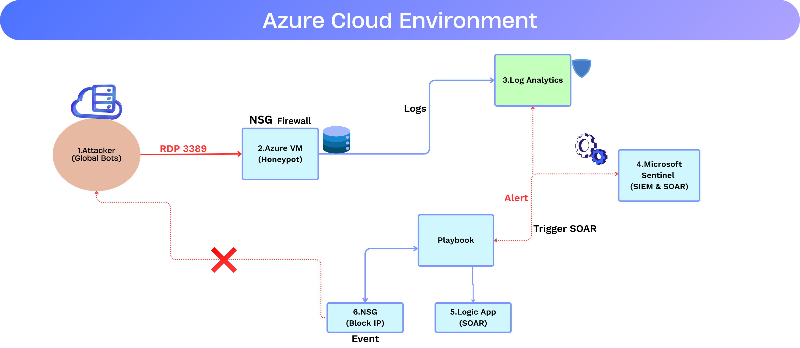
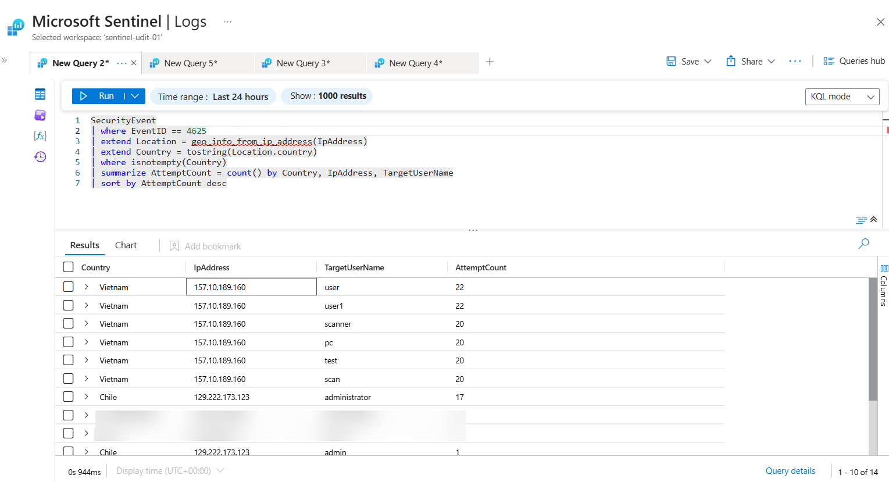

# Sentinel SIEM & SOAR Lab: Azure Honeypot Brute-Force Detection

A cloud SOC lab built on Microsoft Azure. I exposed a Windows Server 2022 VM over RDP (3389) as a honeypot, streamed its security logs into **Microsoft Sentinel**, wrote **KQL** to detect brute-force activity, and attached an **Azure Logic Apps** playbook to the resulting incidents.

### 🛠️ Technologies
* **Cloud:** Microsoft Azure (VM, Log Analytics workspace `sentinel-udit-01`)
* **SIEM / SOAR:** Microsoft Sentinel, Azure Logic Apps
* **Query language:** KQL
* **Network control:** Network Security Group (NSG)
* **Threat intel:** Shodan, IP geolocation (`geo_info_from_ip_address`)

---



## 🏗️ How it works
1. **Attack ingress:** automated bots found the exposed RDP port and started password guessing.
2. **Log ingestion:** every failed logon (Windows **Event ID 4625**) is sent to the Log Analytics workspace and read by Sentinel.
3. **Detection:** a scheduled analytics rule, **Auto-Block Brute Force**, runs every **5 minutes** over the **last 1 hour**. It raises a **High** severity incident when a single IP has **more than 50** failed logons. It is mapped to **MITRE ATT&CK T1110 (Brute Force)**, and the attacker IP is mapped as an entity.
4. **Response:** the incident triggers the Logic App playbook `Notify-Security-Team`. The planned NSG auto-block action is documented in [`playbooks/`](playbooks/).

## 🔍 Results
| Metric | Value |
| :--- | :--- |
| Failed RDP logons (Event 4625) | **~500** (489 in the workbook view, 519 in a 24-hour query) |
| Source countries | **7** (Vietnam, Chile, Netherlands, India, Hong Kong, Romania, Belgium) |
| Top source | Vietnam, single IP `157.10.189.160` (FPT Telecom, AS140766), confirmed with Shodan |
| Usernames tried | `user`, `user1`, `scanner`, `pc`, `test`, `administrator`, `admin` (dictionary attack) |
| Incidents raised | Incident #1 "Auto-Block Brute Force", High, Credential Access |

### Attack by source IP and account


### Attempts by country (workbook)


### Incident in Microsoft Defender / Sentinel


### Playbook runs


## 🔎 Key queries
All KQL lives in [`detections/`](detections/). The analytics rule:

```kql
SecurityEvent
| where EventID == 4625
| summarize FailedCount = count() by IpAddress
| where FailedCount > 50
| extend IPCustomEntity = IpAddress
```

Attempts by country:

```kql
SecurityEvent
| where EventID == 4625
| extend Country = tostring(geo_info_from_ip_address(IpAddress).country)
| summarize AttemptCount = count() by Country
| sort by AttemptCount desc
```

## 🧠 Lessons learned
- An internet-exposed RDP port was found and attacked by bots very quickly, which shows why management ports should sit behind Azure Bastion or a VPN (see my [Bastion lab](https://github.com/uditprak/Secure-Management-Access-via-Azure-Bastion)).
- One IP produced almost all the noise. A per-IP threshold catches it with very few false positives.
- Mapping the IP as an entity makes the incident actionable: the playbook can read it directly.
- Next steps: finish the NSG block action, export the playbook JSON, and tune the rule to also alert on a success-after-failure pattern (`detections/success-after-failures.kql`).
